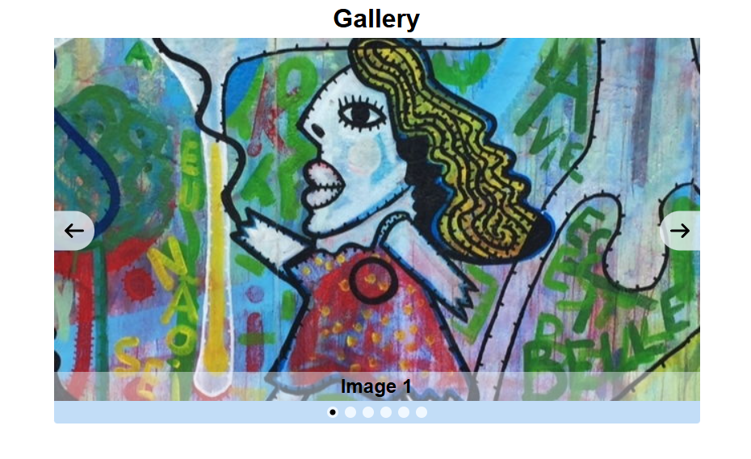

# Sliding Gallery



A responsive sliding image gallery built with JavaScript, HTML, and CSS.
The gallery supports swipe gestures on touch devices and smooth navigation between images.

## Features

- Responsive image gallery
- Touch swipe support for mobile devices
- Smooth sliding animations
- Lightweight and dependency-free
- Easy to customize
- Keyboard and button navigation

---

## Technologies Used

- HTML5
- CSS3
- JavaScript (Vanilla JS)

---

## Installation

Clone the repository:

```bash
git clone https://github.com/steenhl/sliding-gallery.git
```

Go to the project folder:

```bash
cd sliding-gallery
```

Open `index.html` in your browser.

---

## Project Structure

```plaintext
sliding-gallery/
│
├── index.html
├── style.css
├── script.js
└── assets/
```

---

## Usage

The gallery can be navigated by:

- Swiping left or right on touch devices
- Using navigation buttons
- Keyboard arrow keys (if enabled)

Example swipe detection:

```javascript
let startX = 0;
let endX = 0;

gallery.addEventListener("touchstart", (event) => {
  startX = event.touches[0].clientX;
});

gallery.addEventListener("touchend", (event) => {
  endX = event.changedTouches[0].clientX;

  if (startX - endX > 50) {
    console.log("Swiped left");
  }

  if (endX - startX > 50) {
    console.log("Swiped right");
  }
});
```

---

## License

This project is licensed under the MIT License.

---

## Author

Created by Steen Hjalmar Larsen
